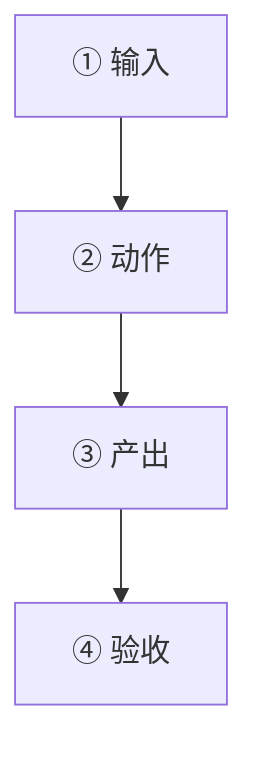

# 流程笔记模板

> [!abstract] 一句话讲清楚
> 这个模板用于"讲清楚一件事从头到尾怎么做"的笔记。核心是四段式：输入 → 动作 → 输出 → 验收。

````markdown
---
title: "流程名"
aliases: [别名1, 别名2]
tags:
  - 领域/<领域名>
  - 类型/流程
  - 难度/<入门|进阶|高级>
created: 2026-10-28
updated: 2026-10-28
---

# 流程名

> [!abstract] 一句话讲清楚
> （这个流程的目标是什么、产出什么）

## 适用场景与前提

- 什么时候用这个流程：
- 前置条件（硬件 / 环境 / 已有模型 / 权限）：
- 不适用的情况：

## 核心名词全解

| 名词 | 英文 / 缩写 | 大白话解释 | 容易混淆 / 注意 |
|---|---|---|---|
|  |  |  |  |

## 整体流程图



## 分步详解

### 第 1 步：xxx

- **输入**：
- **做什么**：
- **为什么**：
- **输出**：
- **验收标准**：（怎么知道这步成功了）
- **失败表现**：（这步失败会看到什么现象）

### 第 2 步：xxx

（同上，逐步展开到流程结束）

## 决策点

> 流程里每个岔路口都写清楚：条件 → 判断依据 → 推荐 → 代价。

- **岔路口 1**：

## 关键参数说明

| 参数 | 作用 | 调大/调小的影响 | 常见取值 |
|---|---|---|---|
|  |  |  |  |

## 常见坑与误区

| 现象 | 原因 | 对策 |
|---|---|---|
|  |  |  |

## 验收清单

- [ ] 服务能起来 / 功能能用
- [ ] 性能达标（延迟、显存、并发）
- [ ] 有日志 / 有文档 / 可交付
- [ ] 出问题能复现、能定位

## 自检问题

- [ ] 

## 相关笔记

- 上游：[[ ]]
- 下游：[[ ]]
- 排错：[[ ]]
- 返回：[[ ]]

## 交付视角（对客户怎么讲）

- 
````
