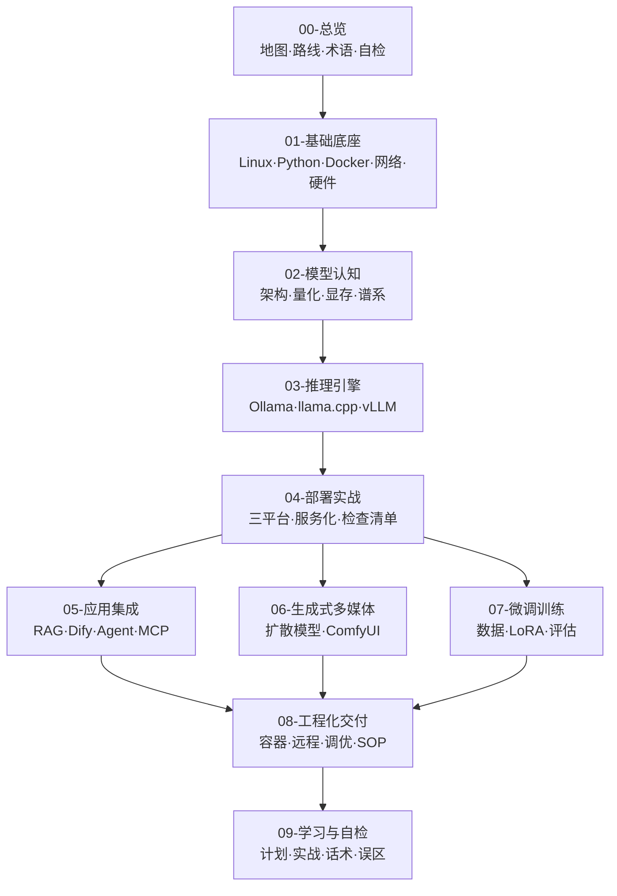

# 本地大模型部署技能栈 · 学习知识库

> [!abstract] 一句话讲清楚
> 这是一个**从零到能接单交付**的本地大模型部署知识库：覆盖基础底座、模型认知、推理引擎、部署实战、应用集成、生成式多媒体、微调训练、工程化交付 8 大领域。每个专业名词都有人话解释，每个流程都有岔路口判断。

---

## 一、这个库怎么用

### 3 种使用方式

| 场景 | 入口 | 说明 |
|---|---|---|
| **系统学习** | [[学习路线图]] → [[8 周学习计划]] | 按顺序读，每阶段有验收标准 |
| **临时查阅** | [[术语总表]] / 各领域 MOC / Obsidian 全局搜索 | 忘了名词就查表 |
| **干活时对照** | [[本地部署全流程]] / [[部署检查清单]] / [[排错方法论]] | 边做边打勾 |

### Obsidian 使用建议

1. **打开方式**：Obsidian → 打开文件夹作为库 → 选 `llm-er` 目录。
2. **快捷键**：`Ctrl+O` 快速切换笔记，`Ctrl+Shift+F` 全库搜索，`Ctrl+G` 看图谱。
3. **图谱视图**：本项目双链很密，图谱能直观看到"哪些概念是枢纽"。
4. **标签面板**：按 `领域/`、`类型/`、`难度/` 三层筛选。
5. **自己补充**：新建笔记请先读 [[写作规范]]，套用 [[概念笔记模板]] 或 [[流程笔记模板]]。

### 自测与对答案

每篇主干笔记（76 篇）末尾都有两节配套内容：

1. **自检问题**：6~10 条 `- [ ]` 自测项，读完先自己回答，能答出来才算真懂。
2. **自检问题参考答案**：紧跟其后的折叠块（`> [!success]-`），点开才显示答案——先自己说一遍，再对照，比直接读答案有效得多。

全库共 **589 条**自检项与对应答案，答案都落在该篇的公式、表格、阈值上，不是泛泛而谈。

### 三个"必须自己会"的判断（不能外包）

1. **算显存账** —— 这台机器能跑多大模型 → [[参数量与显存估算]]
2. **选型判断** —— 该用哪个引擎、哪个量化、要不要微调 → [[推理引擎选型决策树]]、[[微调决策与 RAG 取舍]]
3. **排错分层** —— 问题出在硬件/驱动/框架/参数/应用哪一层 → [[排错方法论]]

其余全是操作细节，随时查、随时问。

---

## 二、全库地图

| 领域 | 一句话职责 | 入口 |
|---|---|---|
| 00-总览 | 全局地图、学习路径、术语词典 | [[技能栈总览 MOC]] |
| 01-基础底座 | 不学这层，后面全是玄学 | [[基础底座 MOC]] |
| 02-模型认知 | 决定你会不会选型和算账 | [[模型认知 MOC]] |
| 03-推理引擎 | 把模型跑起来的手艺 | [[推理引擎 MOC]] |
| 04-部署实战 | 一套可复制的落地流程 | [[部署实战 MOC]] |
| 05-应用集成 | 把模型变成"能干活" | [[应用集成 MOC]] |
| 06-生成式多媒体 | 图像/视频/音频生成 | [[生成式多媒体 MOC]] |
| 07-微调训练 | 私有数据定制模型 | [[微调训练 MOC]] |
| 08-工程化交付 | 靠这套赚钱的部分 | [[工程化交付 MOC]] |
| 09-学习与自检 | 计划、实战、话术、避坑 | [[学习与自检 MOC]] |
| 90-模板 | 写作规范与模板 | [[写作规范]] |

---

## 三、核心主线（先读这 5 篇）

如果你只有 30 分钟，按这个顺序读：

1. [[技能栈总览 MOC]] —— 先建立全局地图
2. [[参数量与显存估算]] —— 会算账，才不会被营销话术带偏
3. [[推理引擎选型决策树]] —— 知道什么情况用哪个引擎
4. [[本地部署全流程]] —— 知道一次交付从头到尾长什么样
5. [[排错方法论]] —— 知道出问题怎么定位

---

## 四、知识库约定

- 文件名**全库唯一**，双链按文件名解析。
- 每篇笔记统一结构：一句话定义 → 为什么重要 → 名词全解 → 原理 → 流程/对比 → 决策点 → 参数 → 坑 → 自检 → 相关笔记 → 交付视角。
- 标签受控：`领域/`、`类型/`、`难度/` 三层，详见 [[写作规范]]。
- 不含大段安装代码：**代码只保留关键参数**，装环境这类流水账直接问 AI 要即可。
- 模型版本迭代快，本库强调**方法**而非背版本号：看模型卡、自己压测、按公式估算。

---

## 五、维护方式

- **新增知识**：套模板写新笔记 → 在对应领域 MOC 里加一行 → 在 `## 相关笔记` 里双向链接。
- **补充细节**：在原笔记对应章节里加，不要另起一篇碎笔记。
- **踩过的坑**：用 [[排错记录模板]] 记到 [[故障案例库]]，这是最值钱的资产。
- **交付完的项目**：用 [[项目复盘模板]] 记一笔，修正你的报价和工期模型。

---

## 相关笔记

- [[技能栈总览 MOC]]
- [[学习路线图]]
- [[术语总表]]
- [[能力自检清单]]
- [[写作规范]]
